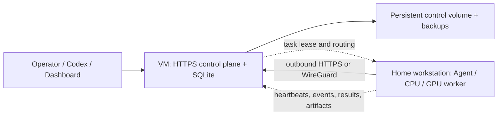

# Cross-Site VM + Home Worker Deployment

This is the target production shape for Nado: a small, public or privately routed VM owns control and persistence, while a more powerful home machine executes shell and terminal-Agent work. The home network does not expose an inbound port. Every registration, heartbeat, claim, event, result, and artifact request is initiated outbound by the worker.



## Choose one network path

Use the private-overlay path when all operators and workers can join the same Tailnet/WireGuard network. It minimizes public attack surface. Use public HTTPS when workers cannot install an overlay client or must connect from arbitrary networks. Do not expose plain HTTP on the public internet.

### Path A: Tailscale/WireGuard private overlay

1. Install Tailscale (or configure WireGuard) on the VM and home machine.
   Restrictive starting policies and WireGuard peer templates are in `deploy/overlay/`; review and substitute them instead of committing generated keys.
2. Confirm the home machine can reach the VM overlay address, for example `100.64.10.20`.
3. On the VM, configure `.env`:

```dotenv
NADO_TOKEN=<long-random-admin-token>
NADO_STORE=sqlite
NADO_DOCKER_HOST_IP=100.64.10.20
NADO_PUBLIC_CONTROL_URL=http://100.64.10.20:8765
NADO_TASK_LEASE_MS=60000
NADO_AUTO_RECOVER_OFFLINE_MS=120000
NADO_CONTROL_DATA_LEASE_TIMEOUT_MS=60000
NADO_CONTROL_DATA_LEASE_HEARTBEAT_MS=10000
NADO_WORKER_LONG_POLL_MS=20000
```

`NADO_TOKEN` is consumed from the environment but never echoed by `control start` or `quickstart`; normal container/service logs show only a redacted credential source. If provisioning must generate the credential, use `--generate-token-file <private-path-outside-control-data>` and install that file through the VM secret workflow. A remote-facing process refuses implicit terminal generation, and the generated file cannot be placed in the backed-up Control data directory.

4. Start the VM control plane:

```bash
docker compose -f docker-compose.azure.yml up -d --build
```

5. Permit TCP 8765 only on the overlay interface/firewall. Do not add a public-cloud inbound rule for 8765.
   On the VM, capture a machine-readable binding receipt before onboarding:

```bash
NADO_TOKEN="$NADO_TOKEN" node ./src/cli.js deployment check \
  --control http://100.64.10.20:8765 \
  --overlay tailscale \
  --overlay-interface tailscale0 \
  --require-container-hardening \
  --out ./overlay-deployment-check.json \
  --json
```

For WireGuard use `--control http://10.77.0.1:8765 --overlay wireguard --overlay-interface wg0 --require-container-hardening`. This verifies that the URL belongs to the selected overlay, is assigned to the VM's local overlay interface, the live Compose service publishes 8765 only there (plus optional loopback), reaches the authenticated Control API directly, matches `NADO_PUBLIC_CONTROL_URL`, and runs the hardened non-root Control process. Pass `--compose-file` when using a non-default Compose file. It does not replace Tailnet policy/WireGuard peer inspection or an Internet-side firewall denial probe.
6. Generate the worker package with the overlay URL embedded:

```bash
NADO_TOKEN=<admin-token> node ./src/cli.js worker bootstrap-bundle \
  --control http://100.64.10.20:8765 \
  --bundle-control-url http://100.64.10.20:8765 \
  --capability code --agent codex \
  --strict-local-readiness \
  --out ./home-worker.zip
```

7. Copy the ZIP to the home machine and run its `start-worker.sh` (Ubuntu/WSL/macOS) or PowerShell start script once interactively. The package first applies the strict local gate, then creates a worker keypair locally and exchanges its one-use enrollment credential for a revocable worker-scoped token. After signed online preflight, it validates the persisted matching Ed25519 identity before the long-running Worker starts. Stop that foreground run after verification, then install persistence with `bash ./install-systemd.sh` on Ubuntu, `.\install-scheduled-task.ps1` on native Windows, or `bash ./install-launchd.sh` on macOS. Systemd runs as the invoking non-root Agent login after network-online; the Windows task and macOS LaunchAgent run at that user's logon so terminal-Agent credentials remain available. The macOS installer validates a private plist, uses failure-only restart, and never creates a root LaunchDaemon; the Agent login must remain active. Use `journalctl -u nado-worker -f`, Task Scheduler history, or `launchctl print gui/$(id -u)/com.nado.worker` plus `.nado/logs` for runtime diagnosis. Matching uninstall scripts retain `.nado` identity and workspaces.

For the first production bundle, set an absolute host-local `--data-dir` outside the extracted bundle, for example `/var/lib/nado-home-worker` for the dedicated Linux login or `C:\\Users\\agent\\.nado-home-worker` on Windows. Use that exact path for every later bundle. This separates replaceable runtime files from the signed identity, session workspaces, partial transfers, and logs needed across upgrades.

### Upgrade And Roll Back A Home Worker

1. From Control, drain the Worker and wait for `runningSlots=0`; do not upgrade a process that still owns a task lease.
2. Generate a new self-service bundle from the target Control release with the same absolute `--data-dir`, capabilities, labels, Agent preset, and service name. Extract it beside the old bundle rather than overwriting the verified rollback runtime.
3. On the home host, run the new runtime's `node ./src/cli.js worker inspect --data-dir <stable-data-dir> --require-identity --json`. Confirm the saved Worker ID/keypair and required GPU/Agent tools before stopping the installed service.
4. Run the new bundle's normal installer. Reinstallation replaces the runtime path and restarts systemd or the Windows scheduled task; the macOS installer boots out and replaces the LaunchAgent. Installer definitions contain no Worker token or private key. Never start both bundles against the same data directory.
5. On Control, confirm `nado workers` reports the expected build and a new Worker runtime, run a target-pinned Doctor/Agent self-test, then resume scheduling. Revoke or prune the newly issued enrollment token if bootstrap reused the existing identity without consuming it.

If verification fails, drain/stop the new runtime and rerun the previous bundle's installer with the same service name and unchanged stable data directory. Do not delete, copy, or replace that data directory during rollback. Keep the previous runtime until the strict live gate and normal workload smoke test both pass.

Before enrollment, confirm both hosts synchronize time: use `timedatectl status` plus `chronyc tracking` or `systemctl status systemd-timesyncd` on Linux, `w32tm /query /status` plus `w32tm /resync` on Windows, or enable automatic date/time under macOS System Settings and verify the clock before starting the LaunchAgent. Worker preflight measures the Control health response round trip, estimates the midpoint-adjusted clock offset, warns above 60 seconds, and refuses startup with a 30-second safety reserve before the five-minute Ed25519 timestamp limit. Fix the host time service; do not enlarge the replay window.

The HTTP URL is acceptable only because the overlay encrypts and authenticates network traffic. Use overlay ACLs to allow worker-to-VM 8765 and operator-to-VM 8765, while denying lateral worker-to-worker access unless needed.

### Path B: public HTTPS with Caddy

1. Point `nado.example.com` to the VM, allow inbound TCP 80/443, and keep TCP 8765 closed publicly.
2. Configure `.env`:

```dotenv
NADO_TOKEN=<long-random-admin-token>
NADO_STORE=sqlite
NADO_DOCKER_HOST_IP=127.0.0.1
NADO_PUBLIC_CONTROL_URL=https://nado.example.com
NADO_DOMAIN=nado.example.com
NADO_TRUST_PROXY=true
NADO_TRUST_PROXY_SECRET=<distinct-output-of-openssl-rand-hex-32>
NADO_TASK_LEASE_MS=60000
NADO_AUTO_RECOVER_OFFLINE_MS=120000
NADO_CONTROL_DATA_LEASE_TIMEOUT_MS=60000
NADO_CONTROL_DATA_LEASE_HEARTBEAT_MS=10000
NADO_WORKER_LONG_POLL_MS=20000
```

3. Validate and start the bundled Caddy overlay:

```bash
docker compose -f docker-compose.azure.yml -f docker-compose.azure-https.yml config --quiet
docker compose -f docker-compose.azure.yml -f docker-compose.azure-https.yml up -d --build
```

The overlay requires the same proxy secret for both services, forces Nado trusted-proxy mode, mounts `deploy/caddy/Caddyfile` read-only, and keeps the native control publication on `127.0.0.1:8765`. Caddy overwrites the proxy authentication and forwarded source/protocol/host headers rather than preserving client-supplied values.

4. Start/reload Caddy and verify `https://nado.example.com/health`.
5. Generate the bootstrap bundle using the public HTTPS URL and start it on the home machine as shown above.

Caddy manages certificates and forwards event streams without opening an inbound connection to the worker. Keep the Nado admin token out of worker configuration; remote workers should use enrolled worker-scoped credentials and signed requests. A host-installed or managed proxy remains supported, but it must enforce the same header overwrite contract and reach only a private/loopback backend.

Caddy supplies `X-Forwarded-For` and `X-Forwarded-Proto`; Nado accepts them only when trusted-proxy mode is enabled and the request carries the matching `X-Nado-Proxy-Secret`. Missing or invalid proxy authentication causes all forwarded headers to be ignored. Keep port 8765 bound to loopback/private networking as defense in depth, rotate the proxy secret independently of Worker/admin tokens, and never expose it to Workers or browsers.

## Inspect the home Worker offline

Before opening a WAN troubleshooting session, run the local inspection from the extracted Worker bundle or repository. It makes no control-plane request and can therefore separate host/runtime failures from DNS, TLS, proxy, overlay, and credential failures:

```bash
node ./src/cli.js worker inspect \
  --data-dir .nado \
  --agent codex \
  --require-agent \
  --require-gpu \
  --require-capability code \
  --tool amd-smi \
  --platform linux \
  --arch x64 \
  --cpu 8 \
  --memory 32GiB \
  --gpu-count 1 \
  --vram 16GiB \
  --gpu-model MI300 \
  --out ./worker-inspect.json
```

Use `nvidia-smi` and the actual GPU model on an NVIDIA host. A strict failure exits with code `2` and lists concrete next actions. The saved JSON contains hardware/tool/readiness evidence but omits Worker tokens and private keys. Omit `--require-identity` before first enrollment; after a successful bootstrap, add it to verify the stored Worker ID, scoped token presence, and matching Ed25519 public/private keypair. This is not WAN acceptance: follow it with the signed online `worker preflight`, `doctor --agent-self-test`, and the real two-host acceptance workflow below.

Use task/session `--platform` and `--arch` constraints whenever the payload is not portable, for example `--platform darwin --arch arm64` for an Apple Silicon build or `--platform win32 --arch x64` for a native Windows tool. The scheduler normalizes common aliases, rejects Workers with missing or mismatched inventory, records the exact candidate reason, and repeats the same check when the Worker claims the task. Labels remain appropriate for site/ownership policy but are no longer required to represent OS or CPU architecture.

For repeatable production onboarding, generate the bundle with `--strict-local-readiness` (the Dashboard self-service checkbox is enabled by default). The start command performs the pre-enrollment host gate automatically and repeats the identity portion after signed preflight. Declaring `gpu` then requires actual vendor-reported devices/VRAM rather than an advertised label, while selecting `codex` or `claude` requires that exact CLI. A damaged local keypair is not reused; issue a fresh enrollment token/bundle to regenerate it.

## Reliability contract

- A claim creates a unique attempt ID and a 60-second execution lease by default (`NADO_TASK_LEASE_MS`).
- A worker heartbeat renews only leases belonging to that worker and current attempt. An expired lease cannot be resurrected by a late heartbeat.
- Local command completion does not release the Worker slot until the result is accepted or the bounded delivery budget is exhausted. Network failures plus HTTP `408`, `425`, `429`, and `5xx` responses retry; permanent HTTP errors stop immediately. During retries, heartbeats continue renewing the same attempt lease.
- Completion delivery defaults to 16 attempts with exponential delays from 250 ms to 5 seconds. Configure `NADO_WORKER_COMPLETION_RETRIES`, `NADO_WORKER_COMPLETION_RETRY_BASE_MS`, and `NADO_WORKER_COMPLETION_RETRY_MAX_MS`; keep the total retry window below the lease duration unless a longer failover delay is intentional.
- Live task events use stable IDs and an ordered queue with eight transient attempts from 250 ms to 5 seconds. Configure `NADO_TASK_EVENT_RETRIES`, `NADO_TASK_EVENT_RETRY_BASE_MS`, `NADO_TASK_EVENT_RETRY_MAX_MS`, and the default 256-event `NADO_TASK_EVENT_MAX_PENDING` bound. A lost response is replay-safe; queue overflow or an exhausted delivery budget is represented by `output_delivery_gap`, while final bounded stdout/stderr still arrives with task completion.
- Critical post-process Worker evidence uses stable IDs and an eight-attempt transient-delivery budget from 250 ms to 5 seconds. Configure `NADO_WORKER_EVENT_RETRIES`, `NADO_WORKER_EVENT_RETRY_BASE_MS`, and `NADO_WORKER_EVENT_RETRY_MAX_MS`; replay after a lost response is deduplicated while the task-bound copy remains durable.
- Cancellation and normal Worker service shutdown terminate the complete child tree. Windows stops descendants leaf-first before the PowerShell wrapper; Linux/macOS signal an isolated process group and escalate from `SIGTERM` to `SIGKILL` after two seconds. Shutdown waits for the child to close and for bounded `task_released` delivery. Keep the generated OS service wrapper enabled so a hard Worker crash is additionally contained by systemd, Task Scheduler, or launchd rather than relying on application cleanup that cannot run after `SIGKILL` or power loss.
- If the gateway committed a result but its response was lost, a replay is recognized from the attempt's terminal or `retry_scheduled` event and treated as accepted. Results from expired or superseded attempts remain rejected.
- Events and results arriving after lease expiry or from an older attempt are ignored.
- Automatic recovery is opt-in (`NADO_AUTO_RECOVER_OFFLINE_MS`). When enabled, the supervisor recovers non-session work after either its lease expires or the worker exceeds the offline grace period.
- `maxAttempts` defaults to 3. Recovery uses bounded exponential delay from `retryBackoffMs` (default 1 second) up to `maxRetryBackoffMs` (default 60 seconds). Exhausted work becomes `failed` with a `retry_exhausted` event.
- Process failures are terminal by default. For commands that are safe to repeat, `retryPolicy.failureKinds` can opt into `timeout`, `process_error`, `worker_error`, or `nonzero_exit`, while `retryPolicy.exitCodes` can match exact positive exit codes. Cancellation and configuration errors are deliberately excluded. CLI uses `--retry-on` and `--retry-exit-code`; Dashboard exposes the same policy under Failure Retry Policy.
- `idempotencyKey` deduplicates repeated task-submission requests. It cannot undo external effects performed by a command before connectivity was lost.
- Delivery remains **at least once**. Commands that mutate external systems should use their own transaction/request keys or otherwise be safe to repeat.
- An idle home worker holds one outbound long-poll claim for up to 20 seconds. The VM wakes it when compatible work arrives; `NADO_WORKER_LONG_POLL_MS=0` restores fixed polling for proxy troubleshooting.
- Session tasks are automatically retried only on their original session-affine Worker, so a temporarily disconnected home machine can reconnect and continue from its deterministic local workspace. Nado never automatically moves that session to another Worker. Use manual `--include-sessions --target-worker <id>` recovery only when loss of the original workspace is acceptable.

## Large input and artifact transfer

Small outputs remain embedded in the normal task-result JSON for compatibility. Files above `NADO_ARTIFACT_INLINE_MAX_BYTES` (5 MiB by default), or files that exceed the 20 MiB inline-total budget, use an attempt-bound upload session:

1. The worker hashes the file without loading it into memory and creates or resumes an upload session.
2. Raw chunks (4 MiB by default) are written directly to a control-side `.part` file. The committed byte offset is persisted after each chunk.
3. A retry first reads the committed offset, so a lost response or VM restart does not restart the whole file.
4. Every chunk is SHA-256 checked. Finalization streams the complete file through SHA-256 and atomically renames it only when declared size and digest match.
5. Upload, status, chunk, finalization, and task completion all require the assigned Worker and current live attempt. A recovered or expired attempt cannot attach its output to the new run.

Tune `NADO_ARTIFACT_CHUNK_BYTES` for the WAN path; 4–8 MiB is a practical default. Reverse proxies must allow request bodies at least as large as one chunk. `NADO_ARTIFACT_MAX_FILE_BYTES` and `NADO_ARTIFACT_MAX_TOTAL_BYTES` are hard worker-side collection limits. Non-session workspace cleanup is deferred until every chunk is finalized.

The reverse direction uses the same durability principles. Large CLI or Dashboard files create task-bound input upload slots, and the task remains `uploading_inputs` instead of entering the scheduler. The VM persists each committed chunk offset and verifies the whole file before changing the task to `queued`. Once claimed, only the assigned Worker/current attempt can download those inputs; downloads use `Range: bytes=<offset>-`, retain a worker-local partial file across transient failures, and verify SHA-256 before the command starts. Dependency artifacts use stored references rather than being copied into task JSON again.

Input defaults mirror artifact defaults: 5 MiB per inline file, 20 MiB inline total, and 4 MiB chunks. Configure `NADO_INPUT_INLINE_MAX_BYTES`, `NADO_INPUT_INLINE_TOTAL_BYTES`, `NADO_INPUT_CHUNK_BYTES`, `NADO_INPUT_MAX_FILE_BYTES`, and `NADO_INPUT_MAX_TOTAL_BYTES` on the machine running the CLI/worker. Browser chunk hashing requires HTTPS (plain HTTP remains supported on localhost); use the CLI for large files on a non-TLS private URL.

For a less stable home uplink, keep worker polling at 2 seconds and choose a lease at least 10 times the normal heartbeat interval. A 60-second lease tolerates short interruptions; increase it if the link regularly stalls longer, accepting slower failover.

## VM operational baseline

- Use the SQLite backend and a persistent Docker volume.
- Keep exactly one Control process on that volume. The normal CLI/container path acquires a heartbeat data-directory lease before loading state and fences every commit; another instance fails even on a different port. Graceful `SIGTERM` releases it immediately, while a hard-crashed owner is reclaimed after `NADO_CONTROL_DATA_LEASE_TIMEOUT_MS`. Do not reduce the timeout below the longest expected VM/storage pause. Confirm `dataLease=owned writeFencing=true` in `nado status` before collecting acceptance evidence.
- Back up the control volume while the service is stopped, or take an application-consistent VM/disk snapshot.
- Keep only SSH from operator addresses and HTTPS 443 open publicly.
- Rotate the admin token with `NADO_ADMIN_TOKENS`, then remove the old token.
- Revoke unused enrollment tokens after onboarding and revoke worker tokens when a home machine is retired or lost.
- Rotate a running self-service Worker from the control host with `NADO_TOKEN="$NADO_TOKEN" node ./src/cli.js worker manage --control <public-or-overlay-url> --id <home-worker> --action rotate_token --wait --evidence ./acceptance-evidence.json`. The command waits while tasks are running, then the home Worker generates and persists the replacement locally, confirms it, proves the new token works and the predecessor returns `401`, and records non-secret evidence. Use direct `worker token rotate --data-dir .nado --verify` only while the Worker process is stopped or concurrent use of the old in-memory credential is otherwise excluded. Use `NADO_WORKER_TOKEN_ROTATION_INTERVAL_MS` only when the desired rotation cadence and monitoring are defined.
- Keep the default API/identity rate limits enabled. Tune `NADO_RATE_LIMIT_*` only after comparing legitimate long-poll/heartbeat traffic with `429` audit events; use edge rate limits as an additional public-HTTPS layer.
- Keep `NADO_JSON_BODY_MAX_BYTES` bounded. Artifact and task-input chunks use separate streaming endpoints and should be sized through their chunk variables and reverse-proxy request limits.
- Review `nado audit --tail 100` after onboarding, token rotation, repeated authentication failures, or recovery operations. Configure `NADO_AUDIT_NDJSON_FILE=/data/audit/nado-audit.ndjson` for the separately mounted Compose audit volume and attach Filebeat, Fluent Bit, Vector, or an equivalent collector; otherwise export `nado audit --out ./nado-audit.ndjson` before the 5,000-event in-store retention window rolls over. Keep the default `NADO_AUDIT_NDJSON_MAX_PENDING=1024` unless measured collector stalls justify a bounded adjustment. Alert when `security.auditSink.state=degraded` or `deliveryIntegrity=incomplete`; backfill missed records from the durable audit API. Status reports only counters/error codes and never the VM path.
- For public HTTPS, run `deployment check --control https://<domain> --backend http://127.0.0.1:8765 --require-https --require-proxy-auth --require-container-hardening --out ./deployment-check.json --json` after deployment or proxy changes. It proves certificate validation, authenticated forwarding, advertised URL correctness, direct-backend separation, and live non-root Control hardening; retain independent NSG/firewall evidence that the backend port is closed from the Internet.
- Run `demo health`, `network`, and `verify --all-workers` after deployment or credential rotation.

On a GPU home Worker, install the vendor runtime before enrollment. NVIDIA hosts should make `nvidia-smi` available. Current AMD ROCm hosts should make `amd-smi` available; Nado merges its static and metric JSON for model, VRAM, temperature, and utilization, then falls back to legacy `rocm-smi --json` when needed. Treat a manually advertised `gpu` capability without one of these probes as unverified and do not use it as the final accelerator acceptance evidence.

On a Windows home Worker, Nado also reads temperature sensors exposed by an already-running LibreHardwareMonitor or OpenHardwareMonitor WMI provider, preferring LibreHardwareMonitor when both publish the same identifier and retaining ACPI as a fallback. Nado does not install, start, or elevate either optional monitor; unavailable providers and invalid readings degrade to an empty sensor list without blocking the Worker.

On a macOS home Worker, Nado can read CPU temperature from an already-installed `osx-cpu-temp` executable on `PATH`. The probe uses direct process execution with a three-second timeout and bounded output, never invokes `sudo`, and degrades to an empty sensor list when the command is absent, fails, or returns an invalid value. Sensor support differs between Intel and Apple Silicon models, so confirm that the Worker inventory contains `source: macos-osx-cpu-temp` on the actual host before treating temperature telemetry as acceptance evidence. Nado deliberately does not fall back to privileged `powermetrics` collection.

The Dashboard's always-visible Cross-Site Topology is the fastest operator check after deployment or restart. It shows the non-persistent control instance and start time, active store/schema versions, any verified restore receipt and manifest SHA-256, plus each Worker's latest control-observed source address, protocol, gateway state, capabilities, and identity mode. Loopback, administrator-token, unsigned-token, and plain-HTTP observations remain visible as evidence; the view does not upgrade them into a production pass.

For a task affected by WAN instability, open Task Detail and read Runtime before manually requeueing it. `running_healthy` means the heartbeat and lease are live; `worker_heartbeat_stale` shows the remaining lease window; `lease_expired` identifies a recoverable ownership loss; `retry_backoff` gives the delayed retry state; and `waiting_for_session_worker` means the task is intentionally pinned to the home Worker that owns its workspace. The same fields are returned as `runtimeDiagnostics` by task APIs and shown in the CLI `tasks` runtime column. Follow the supplied `nextAction`; do not auto-route a recovered session to a different machine unless losing its local context is acceptable.

### Acceptance evidence workflow

Create the template before the drill and fill each scenario with `status`, a concrete evidence note, timestamps, and task/event/log references. Do not mark a scenario passed merely because an automated unit test covers a similar local condition.

The CLI, Dashboard Operations view, HTTP API, and MCP now use one versioned runbook generator, so evidence initialization, deployment boundary checks, operator-only facts, every supervised exercise, credential revocation, and the final strict report cannot drift between interfaces. Generate a resumable checklist first:

```bash
node ./src/cli.js acceptance runbook \
  --control https://nado.example.com \
  --worker home-gpu \
  --deployment-mode public_https \
  --require-gpu \
  --source-data-dir /var/lib/nado \
  --backup-dir /var/backups/nado-acceptance \
  --restored-data-dir /var/lib/nado-restored \
  --out ./acceptance-runbook.sh
```

For private transport select `--deployment-mode tailscale|wireguard --overlay-interface tailscale0|wg0`. Operator-only evidence commands remain commented until their `REPLACE_ME` values are edited, and evidence validation rejects those placeholders if submitted. `acceptance evidence init` is idempotent, preserves completed scenarios, and adds any missing template scenarios. The final command passes `--deployment-evidence`, so the strict report verifies the receipt version, current Control URL, deployment mode, every required boundary check, and a generation time no older than 24 hours or more than five minutes in the future instead of merely trusting that step 1 was run. Rerun deployment checking immediately before the final report when a drill spans more than one day. The Dashboard copies this same server-generated script; MCP clients use `nado_acceptance_runbook`.

Use **Run Live Gate** before starting disruptive drills. Load the runbook-produced `deployment-check.json` and `acceptance-evidence.json` in the two JSON fields first; the browser keeps them in memory only, submits both to the report API, always requires a deployment-boundary receipt, and maps the shared runbook into validated/pass/fail/pending step status. With **Run end-to-end verify tasks** unchecked it evaluates the current URL, observed Worker connection, signed identity, SQLite/recovery configuration, telemetry, and optional GPU/Agent requirements without creating diagnostic tasks. Check it only when the selected Worker is idle and an explicit task/artifact/batch verify run is desired. The result separates automatic checks from mandatory operator evidence and can be downloaded as JSON; a green verify row never turns missing physical separation, no-inbound-port, disconnect, restart, transfer, revocation, or restore evidence into a pass.

The expanded core exercise sequence is shown below for reference; the generated runbook above is authoritative:

```bash
node ./src/cli.js acceptance template --out ./acceptance-evidence.json
NADO_TOKEN="$NADO_TOKEN" node ./src/cli.js acceptance exercise remote-cancellation \
  --control https://nado.example.com \
  --worker home-gpu \
  --evidence ./acceptance-evidence.json
NADO_TOKEN="$NADO_TOKEN" node ./src/cli.js acceptance exercise short-disconnect \
  --control https://nado.example.com \
  --worker home-gpu \
  --evidence ./acceptance-evidence.json
NADO_TOKEN="$NADO_TOKEN" node ./src/cli.js acceptance exercise long-disconnect-recovery \
  --control https://nado.example.com \
  --worker home-gpu \
  --evidence ./acceptance-evidence.json \
  --timeout 300000
NADO_TOKEN="$NADO_TOKEN" node ./src/cli.js acceptance exercise vm-restart-recovery \
  --control https://nado.example.com \
  --worker home-gpu \
  --evidence ./acceptance-evidence.json \
  --timeout 300000
NADO_TOKEN="$NADO_TOKEN" node ./src/cli.js acceptance exercise worker-restart-recovery \
  --control https://nado.example.com \
  --worker home-gpu \
  --evidence ./acceptance-evidence.json \
  --timeout 300000
NADO_TOKEN="$NADO_TOKEN" node ./src/cli.js acceptance exercise large-artifact-resume \
  --control https://nado.example.com \
  --worker home-gpu \
  --evidence ./acceptance-evidence.json \
  --timeout 300000
NADO_TOKEN="$NADO_TOKEN" node ./src/cli.js acceptance exercise large-input-resume \
  --control https://nado.example.com \
  --worker home-gpu \
  --evidence ./acceptance-evidence.json \
  --timeout 300000
NADO_TOKEN="$NADO_TOKEN" node ./src/cli.js acceptance exercise backup-restore \
  --control https://nado.example.com \
  --worker home-gpu \
  --source-data-dir /var/lib/nado \
  --backup-dir /var/backups/nado-acceptance \
  --restored-data-dir /var/lib/nado-restored \
  --evidence ./acceptance-evidence.json \
  --timeout 600000
NADO_TOKEN="$NADO_TOKEN" node ./src/cli.js acceptance exercise agent-collaboration \
  --control https://nado.example.com \
  --worker home-gpu \
  --evidence ./acceptance-evidence.json \
  --timeout 180000
NADO_TOKEN="$NADO_TOKEN" node ./src/cli.js worker manage \
  --control https://nado.example.com \
  --id home-gpu \
  --action rotate_token --wait \
  --evidence ./acceptance-evidence.json
NADO_TOKEN="$NADO_TOKEN" node ./src/cli.js acceptance \
  --control https://nado.example.com \
  --worker home-gpu \
  --require-gpu \
  --run-verify \
  --deployment-evidence ./deployment-check.json \
  --evidence ./acceptance-evidence.json \
  --out ./acceptance-report.json \
  --require-complete
```

The rotation step writes a structured revocation receipt rather than an operator assertion. Final acceptance binds its Worker ID and replacement token ID to the selected Worker's latest signed identity, requires `newTokenAccepted=true`, `previousTokenRejected=true`, and predecessor status `401`, and matches control-triggered receipts to the durable completed `rotate_token` command. If the Worker rotated again, rerun this step so the receipt describes its current identity. Direct stopped-Worker rotation is accepted only after that Worker reconnects with the replacement.

The cancellation exercise starts a bounded long-running Node process on the selected home Worker, cancels it from the VM, waits for that exact Worker to acknowledge `cancel_current`, waits for the Worker-side `task_released` event emitted after the child process closes, verifies the durable cancelled task event, and records structured task/attempt/Worker-event references in the evidence file. It is safe to rerun and creates a new uniquely identified task each time.

The short-disconnect exercise is deliberately supervised because Nado must not disable a real home network interface by itself. When the CLI prints `Disconnect the home Worker network now`, disable the Worker host's WAN/overlay route for at least five seconds; reconnect immediately after the CLI reports the observed heartbeat gap. The VM, not the CLI, computes the live Worker age and records `short_disconnect_gap_observed`; after reconnection it accepts recovery only when the same attempt's lease has advanced and records `short_disconnect_recovered`. Both events retain the Worker and attempt identity in durable task history. Passing requires recovery before the current lease expires, renewal of the same attempt, exactly one execution marker, successful completion, and a verified artifact. Use `--min-disconnect-ms` and `--task-duration-ms` only when the real link and lease policy require a larger window.

For long disconnect, automatic recovery must be enabled (`NADO_AUTO_RECOVER_OFFLINE_MS` non-zero). Keep the original Worker disconnected until the CLI reports that its lease expired and the VM requeued the task, then reconnect it. Passing requires durable first-attempt execution output, `lease_expired` plus `lease_recovered`, a rejected stale/late result from that attempt, a distinct successful second attempt (possibly on another eligible Worker), and a final artifact that identifies attempt sequence 2. This is direct evidence that external side effects may happen more than once; use application-level idempotency keys for mutations.

For VM restart recovery, start the command from an operator terminal that remains available while the VM service restarts. When prompted, restart only the Nado control service or container and preserve the same SQLite data volume; do not restart the home Worker. Passing requires an observed control outage, a new non-persisted control instance ID, the original SQLite task and attempt, an active reconnected Worker, one successful execution, and a SHA-256-verified artifact. Keep the restart shorter than the task lease so this scenario proves same-attempt control recovery rather than lease-expiry reassignment.

For home Worker service restart recovery, the CLI first captures the selected Worker's signed token ID and per-process runtime identity. When prompted, use `sudo systemctl stop nado-worker` on Linux or `Stop-ScheduledTask -TaskName 'Nado Worker'` on Windows, and do not start it again until the VM reports `gatewayState=offline` (normally after 45 seconds). Then use `sudo systemctl start nado-worker` or `Start-ScheduledTask -TaskName 'Nado Worker'`. Passing requires a different control-observed `wrun_*` runtime, the unchanged signed Worker token, a reserved `runtime_started` event linking both runtimes, and a one-attempt probe artifact whose `NADO_WORKER_RUNTIME_ID` matches the restarted process. A quick stop/start that never reaches control-observed offline does not satisfy this drill.

For large artifact resume, the Worker creates a deterministic 64 MiB file by default. Wait for the CLI to report a durable partial offset, then disconnect the home Worker's WAN/overlay route. Reconnect only after the CLI reports that both its heartbeat and that exact upload offset have remained stalled for five seconds. Passing requires the same upload ID and task attempt to finalize from the persisted offset, one task attempt, and a direct download whose size and SHA-256 match the deterministic Worker source. If a very fast link completes before interruption, increase `--artifact-bytes` (up to 512 MiB) or configure a smaller `NADO_ARTIFACT_CHUNK_BYTES` on the Worker before the drill.

For large input resume, the CLI first stages a deterministic 64 MiB input in the VM control store, then the home Worker requests it with an attempt-bound HTTP Range. Disconnect the Worker after the CLI observes the initial offset-0 request, and reconnect only after the reported heartbeat gap. Passing requires a later durable Range event with a positive offset on the same attempt, proving the Worker retained partial bytes locally, plus a Worker-generated result whose size and SHA-256 match the VM-staged source. Increase `--input-bytes` on links that finish before the operator can interrupt them.

For backup restore, the command first creates a target-Worker marker task and verifies its artifact. When prompted, stop the control service, run the documented offline backup and verification commands against `--source-data-dir`, restore into the new and nonexistent `--restored-data-dir`, then start control on the same URL using that restored directory. The restore command writes a path-free receipt containing a random receipt ID and verified backup-manifest SHA-256; old receipts are excluded from later backups. Passing requires an observed outage and new control instance, a fresh receipt created after the prompt, the original marker/artifact, a Worker heartbeat after restart, and a new successful write probe. Keep the original volume unchanged until the strict report passes.

The Agent collaboration exercise first requires `doctor --agent-self-test` evidence for a real Codex/Claude terminal Agent. It pins a session to the selected home Worker, runs two Agent turns, and verifies by direct artifact download that a per-run random marker moved from `agent-plan.md` into `agent-final.md`; it also requires the persisted session transcript and closes the session. Demo echo and unverified custom Agent commands fail before work is created.

Automatic gates inspect the remote Control URL/transport, selected Worker health, outbound connection model, scoped signed identity support, live-bound credential-revocation, remote-cancellation, long-disconnect-recovery, VM-restart-recovery, Worker-service-restart recovery, large-artifact/input-resume, backup-restore, and Agent-collaboration receipts, SQLite/version state, recovery configuration, hardware/network telemetry, optional real GPU evidence, optional real terminal-Agent self-test, and the normal task/artifact/batch verify flow. Manual gates remain mandatory for facts the control plane cannot prove, especially physical/network separation and the home inbound-port policy. Credential rotation, remote cancellation, supervised short/long disconnect, VM restart, Worker service restart, transfer resume, backup/restore, and real Agent collaboration have evidence-producing workflows. A report is `passed` only when every required gate is passed; otherwise it is `pending` or `failed`.

An MCP control-side Agent can carry the evidence document without writing into the VM checkout: call `nado_acceptance_template`, pass the returned document plus one observed result to `nado_record_acceptance_evidence`, and pass the updated document as `manualEvidence` to `nado_acceptance_report`. The equivalent authenticated HTTP endpoints are `GET /api/acceptance/template`, `POST /api/acceptance/evidence/record`, and `POST /api/acceptance/report`. Evidence recording is validation-only and stateless; the operator or Agent must archive the returned document. Generic evidence recording cannot manufacture a credential-revocation pass because the report independently matches its structured receipt to live Worker/control state, and automatic checks still cannot assert physical separation or firewall policy.

The identity gate is bound to the selected Worker, not merely to gateway capabilities. Its latest successful registration/heartbeat must report `identity.type=worker_token`, `scoped=true`, `signed=true`, and `signatureAlgorithm=ed25519`. A fixed-ID Worker still using the administrator token or an unsigned issued token must be replaced/re-enrolled with the self-service bootstrap bundle before production acceptance.

The source gate is also bound to the selected Worker. `connection.remoteAddress` must be non-loopback; `connection.addressSource=x-forwarded-for` is accepted only when the proxy request was authenticated (`connection.proxyAuthenticated=true`). This does not replace the operator's physical-separation/firewall evidence, but it prevents a local Worker or a direct backend client from passing by spoofing forwarded headers or merely making `NADO_PUBLIC_CONTROL_URL` look remote.

The transport gate uses `connection.protocol`, not only the advertised URL. If `NADO_PUBLIC_CONTROL_URL` is HTTPS but the selected Worker reaches port 8765 directly over HTTP, acceptance fails and instructs the operator to close the bypass. An observed HTTP connection passes only when the required `encryptedPrivateOverlay` evidence confirms that Tailscale/WireGuard and its ACLs protect the path.

### Backup and restore drill

Stop the control container before reading its data directory. If the Docker volume is mounted or copied to `./control-data`, create and independently verify a snapshot:

```bash
node ./src/cli.js store backup --data-dir ./control-data --store sqlite --out ./backups/nado-$(date +%F) --offline-confirmed
node ./src/cli.js store verify --from ./backups/nado-$(date +%F)
```

Restore into a new directory or empty replacement volume; the command refuses an existing target:

```bash
node ./src/cli.js store restore --from ./backups/nado-2026-08-19 --data-dir ./control-restored --offline-confirmed
NADO_STORE=sqlite NADO_TOKEN="$NADO_TOKEN" node ./src/cli.js control start --data-dir ./control-restored
```

After startup, run `verify --all-workers`, download a pre-backup artifact, submit a new task, and confirm Worker reconnection. Keep the old volume unchanged until those checks pass. The CLI's `--offline-confirmed` flag is an operator assertion, not an automatic process lock; taking a backup from a running control process is unsupported.

## Cross-site acceptance matrix

| Scenario | Required evidence | Pass condition |
| --- | --- | --- |
| Outbound-only onboarding | VM firewall rules plus worker preflight | Home worker registers with no home-router port forwarding |
| Shell execution | Routed task detail and artifact | VM dispatches; home worker completes; artifact downloads on VM |
| Terminal Agent execution | Agent self-test and transcript/artifact | Real Codex/Claude preset executes on home worker |
| Resource routing | Worker inventory and schedule explanation | CPU/GPU/tool/label constraint selects the intended home worker |
| Short network interruption | Task lease timeline | Heartbeats resume before expiry and the same attempt completes |
| Long network interruption | `lease_recovered`, attempt history | Old attempt loses ownership; task is retried once; stale output is ignored |
| Retry exhaustion | `retry_exhausted` event | Task stops at `maxAttempts` instead of looping forever |
| Duplicate submission | Same `idempotencyKey` submitted twice | Exactly one task ID exists |
| Cancellation | Worker command acknowledgement | VM cancel aborts the home process and reaches terminal state |
| Credential revocation | Worker token list and failed preflight | Revoked home credential can no longer heartbeat, claim, or report |
| VM restart | Status before/after restart | Workers reconnect and SQLite task/session history remains intact |
| Large artifact resume | Stop/restart control after a committed chunk | Worker resumes at persisted offset; downloaded SHA-256 matches the source |
| Large input resume | Stop/restart control during upload; interrupt Worker download | CLI resumes upload offset; Worker resumes byte range; task starts only after SHA-256 passes |
| Stale artifact attempt | Recover the task while an old upload exists | Old Worker/attempt cannot append, finalize, or attach the upload |
| Operational telemetry | Inspect `nado workers`, capabilities, generated `AGENTS.md`, and Dashboard Worker detail | Home Worker reports cross-platform CPU utilization from heartbeat-to-heartbeat OS counters, memory pressure, control RTT, bounded upload/download estimates, data-volume free space, and any available host/GPU temperature sensors; the initial CPU sample, missing sensors, or failed bandwidth samples remain non-fatal |
| Backup restore | Restored VM/control volume | Workers and durable history are readable; a new task completes |
| Backup integrity | `store verify` output plus a deliberate copy-corruption drill | Valid snapshot passes; changed, missing, or extra files fail before restore |

The project is not considered fully cross-site accepted until this matrix is executed on two real hosts across different networks. Docker workers prove protocol behavior but do not prove NAT, WAN, real GPU, or home-uplink behavior.
